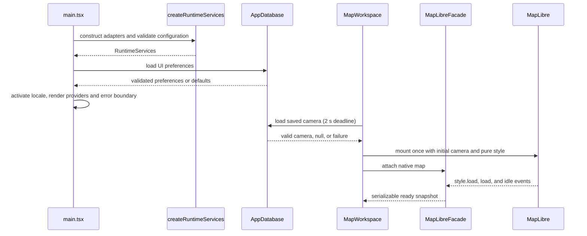
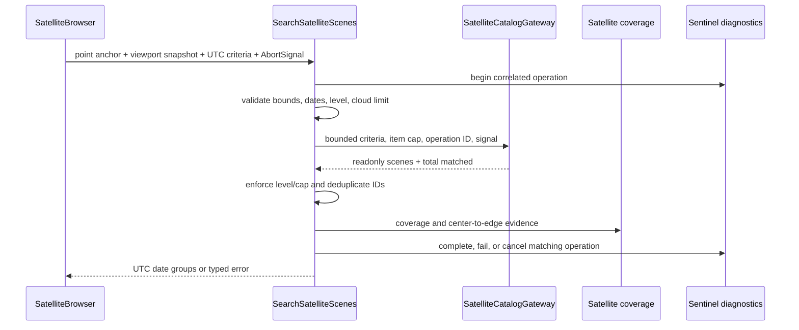
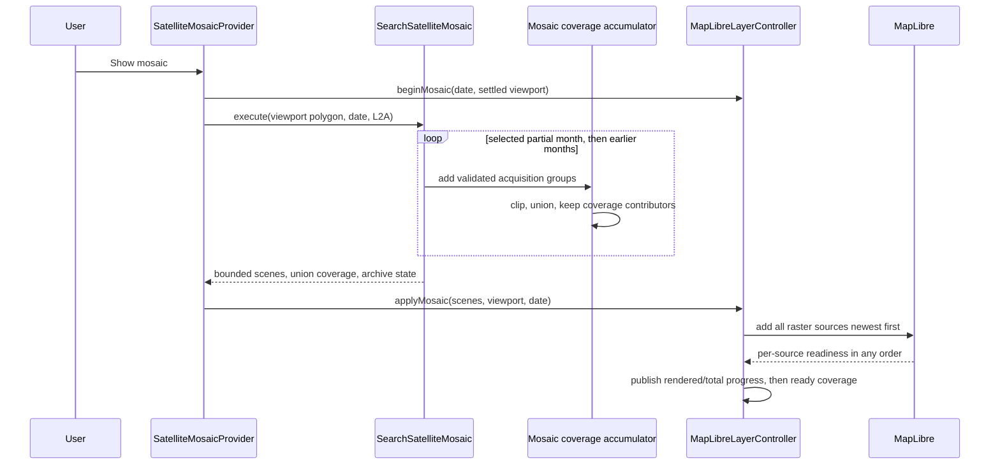
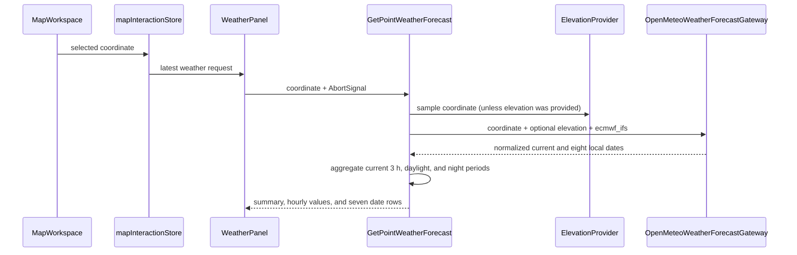
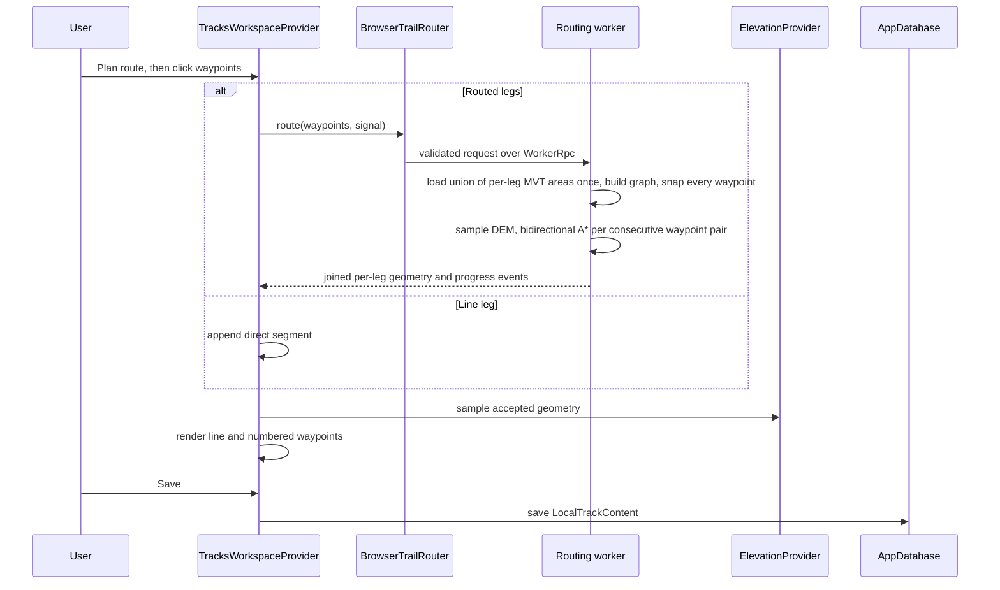
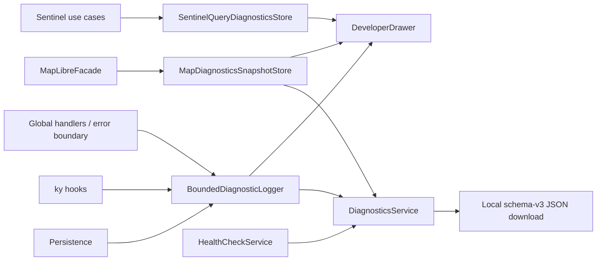

# Runtime flows

Module owners are listed in [project-structure.md](project-structure.md); persisted
records in [data-model.md](data-model.md); user-visible behavior in
[features.md](features.md).

## Startup and map readiness



`runApplicationBootstrap` restores UI preferences and activates the locale before
React's first render, so persisted navigation state and language never flash. A
preference-read failure logs a warning and uses defaults. A configuration failure
renders a fatal alert without contacting providers. A service-construction failure
mounts the pre-React fallback, which can export a minimal bootstrap diagnostics bundle.
Camera failure is recoverable: the map uses `defaultGeorgiaCamera`.

The facade publishes Ready on `style.load`, when MapLibre can accept new sources, rather
than waiting for every basemap and relief tile. `load` and `idle` remain diagnostic
signals; `idle` fires after every repaint, so its timestamp is stored in the diagnostics
snapshot without notifying React. `styledata` republishes source and layer IDs only when
either list changed. Native listeners are registered once and removed at teardown.

`MapWorkspace` publishes the facade's settled WGS84 bounds and center through
`MapViewportSnapshotStore` on style readiness, `moveend`, and the end of a terrain
transition, and publishes `null` on teardown. The initial settle does not wait for full
`load`. A late movement subscriber immediately receives the current settled viewport,
and a numerically equal viewport keeps the previous object. Search, Satellite, and
Mosaic consumers read this store without touching MapLibre.

`MarkersWorkspaceProvider` loads validated saved markers and sends them to
`MapLibreLayerController`. `TracksWorkspaceProvider` separately sends markers owned by
the active preview or saved track to the same source and symbol layer; the controller
combines both owners so neither clears the other.

## Settled map-view write and restore

1. Startup reads one versioned view. A 2D view restores center and zoom with bearing and
   pitch at 0; a 3D view also restores bearing and pitch and selects 3D. A share URL
   replaces the stored view and mode entirely.
2. A restored or shared 3D view mounts as a pitched flat style so DEM tiles cannot delay
   readiness; terrain starts after Ready through the normal retry path. Until that
   attempt settles, settled flat views are still stored as 3D. Selecting 2D or Mosaic
   during loading supersedes that intent, levels the camera, and stores a 2D view.
   Fit-to-bounds commands, such as opening a shared track, wait until that attempt and
   any other terrain transition settle, because a transition ends by restoring the
   camera it started from. A map that is degraded before the attempt fits in 2D at once.
3. On `moveend` the facade reads center, zoom, bearing, pitch, and terrain mode, updates
   its snapshot, and calls the view-settled port. Middle, Shift, and Ctrl drags move the
   camera at most once per frame, each step a separate MapLibre move, and may coast
   briefly after release; their `moveend`s are skipped and the facade settles once when
   the gesture ends.
4. `SettledCameraPersistence` keeps only the newest view during a 400 ms debounce, then
   the repository writes the terrain mode with center and zoom, plus bearing and pitch
   only in 3D. Writes are chained so saves cannot overtake one another.
5. A save failure is logged and shown as a non-blocking warning.

Continuous `move`/render events never reach React, IndexedDB, or diagnostics.

A shared satellite URL opens Satellite and resolves the allowlisted collection/item
without waiting for map readiness. The controller publishes the selected scene to
`mapLayerStore`, so `SatelliteBrowser` can show a one-card result from footprint-derived
coverage before a viewport exists. Raster application and any shared 3D transition start
when the base style is ready. Scene data never enters IndexedDB. A shared static
satellite layer (`base=`) is applied once through `setMapLayerPreset` when the base
style is ready and the stored layer preferences have loaded; `restorePersistedState`
loads them once per controller and returns the same promise to later callers, so the
stored choice cannot overwrite the shared one. It persists like a layer-chooser click.

Share links are built only on explicit actions by `presentation/map/mapShareUrl.ts`:
`readShareableMapState` reads the camera, terrain mode, visible static basemap, and the
selected scene while Sentinel imagery is visible; `selectMapShareView` applies the
`map.share-preferences` record and an optional clicked center; `createMapShareUrl`
writes `map=2`, `lat`, `lon`, `z`, `view`, `bearing`/`pitch` in 3D, `base`, and `scene`,
and reduces an open `#tracks/share/…` capability to `#tracks`. The rail, point
**Share…**, and track **Share…** open `MapShareDialog` through
`mapInteractionStore.shareRequest`, which captures the page URL. The dialog shows its
link and options only after the stored preferences load, so a copy or change never
starts from defaults. Point-action **Copy link** and the Satellite card's **Share link**
read the stored preferences directly. The dialog's `TrackShareTable` reads the drawn
tracks from `TracksWorkspaceProvider`; each row loads, enables, or disables its public
share through `TrackShareService` with its own abortable request, and
`createTrackShareUrl` appends the capability fragment to the dialog's map link. A track
link with a scene stays on Tracks instead of opening Satellite.

The comparison sidebar's **Share link** calls `createComparisonShareUrl`, which writes a
2D map link without `scene` or `base` plus `compare=<key>,…` and `#satellite`; every
other map link drops `compare`. `parseSharedComparison` accepts two to four distinct
keys that each match the scene-key pattern or name a static basemap
(`satelliteBasemaps`) and otherwise returns none. On desktop, `MapWorkspace` opens
Satellite, resolves every scene key through the same allowlisted `getScene` in parallel,
keeps basemap IDs as they are, and calls `openSharedComparison` with the resolved images
in link order and the shared camera when at least two resolve, dropping missing or
failed keys; otherwise it shows a notice. Smartphones and track-share links ignore
`compare`.

`MapWorkspace` also keeps the grid and the `#satellite/compare` anchor in step. A change
of `isComparisonOpen` pushes that anchor or `#satellite`, unless the URL already matches
or the grid closed because another section's anchor was pushed. Once the main map is
ready on desktop and the stored layout has loaded, the initial anchor, `hashchange`, and
`popstate` close the grid when the anchor returns to `#satellite`, or open it with
`reopenComparison`: the last closed grid with its positions and layout while the tray
still holds exactly its images, else `openComparison` as from the Satellite header.

While the grid is open, `WorkspaceShell` hides the mounted main map and the rail, docks
a narrow sidebar, and gives `SatelliteCompareMaps` the remaining area. MapLibre limits
concurrent raster requests for the whole page (16) and TiTiler answers each tile in
about a second, so the grid multiplies that limit by four while mounted and restores it
on unmount; otherwise four panes queue behind each other for tens of seconds. The grid
waits for `restorePersistedState` so panes read stored layer choices, overlay opacity,
rendering mode, and stretch once. `SatelliteCompareSync` copies the moving pane's center
and zoom to the others with `jumpTo` under a guard, re-projects the crosshair on every
move, and reports one settled camera per gesture to `satelliteCompareStore`. Closing the
grid issues a `requestMapNavigation` to that camera with `exactZoom`, so a 3D main map
keeps the compared zoom instead of the terrain close-up zoom.

## Terrain transition

```mermaid
sequenceDiagram
  participant User
  participant UI as MapWorkspace
  participant Facade as MapLibreFacade
  participant Map as MapLibre
  participant DEM as Terrain provider

  User->>UI: select 3D in MapViewControls
  UI->>Facade: setTerrainMode(terrain)
  Facade->>Map: reuse controller-owned raster-dem source
  Facade->>Map: level camera and set terrain
  Map->>DEM: fetch provider WebP tiles directly
  DEM-->>Map: Terrarium-encoded tiles, decoded on MapLibre workers
  alt source becomes ready
    Map-->>Facade: sourcedata loaded
    Facade->>Map: apply the terrain camera from the loaded DEM
    Facade-->>UI: success / terrain
  else error, timeout, or cancellation
    Facade->>Map: clear 3D terrain; retain shared overlay source
    Facade-->>UI: failed / usable flat map
    loop retries after 1 s and 3 s
      UI->>Facade: setTerrainMode(terrain)
      Facade->>Map: refresh DEM tiles under a new retry revision
    end
  end
```

Only one terrain transition runs at a time. Repeated requests for the same target share
its promise; an opposite request fails explicitly. Camera persistence ignores the
internal level-camera commands. Entering 3D levels a pitched flat camera before terrain
changes the elevation reference; leaving 3D levels the camera first and returns it
north-up. Each retry advances a private source revision so MapLibre cannot reuse a
failed tile-cache entry. Final failure appears only in the shared operational status.

## Terrain overlay reconciliation

On style readiness, style data changes, imagery swaps, preference changes, and 3D
transitions, the layer controller idempotently restores the DEM source, relief shade,
sun-shadow raster, generated contour source, minor/index lines, and index labels. The
order is base surface fills, relief/satellite in the selected order, waterways,
contours, water-body polygons, sun shadow, buildings, then OSM boundaries, transport,
ridges and cliffs, the Sentinel scene footprint, user routes and tracks, and finally
icons and labels (contour labels included), so relief and shadow stay visible over
opaque land-cover fills while water bodies mask isolines and shadow. 3D terrain draws
consecutive line, fill, raster, and hillshade layers into one draped texture per terrain
tile, and every icon or label layer between them would add another full set of textures
and terrain passes; keeping all lines and fills below the first icon layer gives the
main map one draped stack. A paint change redraws the draped textures only on its first
frame, so the style disables paint transitions (`transition` of zero): a fade would
freeze them at the previous value, leaving land-cover fills over imagery after a switch
to satellite, or missing after a switch back, until the camera moves. Changing the
contour interval updates the existing vector source's tiles without touching the camera.

The `terrain-dem` raster-dem source points at the provider URL, so MapLibre fetches,
caches, and decodes relief and 3D terrain tiles on its own workers. Contours use a
separate `maplibre-contour` protocol: MapLibre abort signals flow through it, the worker
channel, and the library's shared fetch, parsed-DEM, and contour caches, where each
consumer cancels independently and the producer aborts when the last one releases it.

One module worker owns provider DEM fetches for contours, `createImageBitmap` decoding,
parsed DEM data, and contour generation. `movestart` marks the channel interactive: new
contour requests enter a bounded queue (a full queue cancels its oldest request), and
`moveend` drains contours one at a time. The worker publishes a coordinate-free queue
snapshot that the controller stores in `mapLayerStore`; the operational status shows it
under Ready as the `Contours · …` line.

Provider, timeout, decode, and compute errors fail only their request. A worker `error`,
`messageerror`, channel loss, or malformed result restarts one fresh worker and retries
the request. If the replacement also fails, contours continue through
`InlineTerrainComputeBackend` on the window thread with a non-blocking compatibility
warning; the next page session starts with a worker again. Cached contour buffers are
sliced before transfer so MapLibre detachment cannot corrupt later cache hits. Timing
aggregates exclude tile coordinates, URLs, pixels, and geometry.

The controller also watches the `terrain-dem` source. While visible relief or 3D terrain
waits for DEM tiles for longer than 300 ms, it sets `terrainDemLoading` in
`mapLayerStore`, and the operational status replaces Ready with a pending
`Loading terrain…` line and an indeterminate bar. Shorter loads, such as cached pans, do
not change the status; the flag clears as soon as the source is loaded or no longer in
use.

Applying, hiding, replacing, or clearing satellite imagery reapplies the shared visual
mode on existing layers: opaque land-cover fills switch off over imagery while line
features, hillshade strength, and label halos update atomically. The camera, sources,
and user visibility choices are preserved.

## Terrain sun shadows

```mermaid
sequenceDiagram
  participant Map as MapLibre
  participant Provider as MapLibreTerrainShadowTileProvider
  participant Worker as terrain-shadow worker
  participant DEM as Mapterhorn DEM
  Map->>Provider: terrain-shadow://<epochMinute>/{z}/{x}/{y}
  Provider->>Worker: renderTile (tile, instant, DEM URL, shade colors)
  alt mask cached for tile and minute
    Worker-->>Provider: ImageBitmap colored from the mask
  else
    Worker->>DEM: 3×3 mosaics at z, z−2, z−4 (cached tiles skipped)
    Worker->>Worker: single GPU queue; its head waits until the camera settles
    Worker->>Worker: WebGL2 visibility and shade passes, readback copy, fence wait
    Worker-->>Provider: ImageBitmap colored from the mask (transferred)
  end
  Provider-->>Map: raster tile data
```

While the sun-shadow style is chosen, `terrain-relief` is visible (so neither the user
nor the weather map hides it), and shadows are not known to be unavailable, the
controller keeps the `terrain-sun-shadow` raster source (every zoom up to z12,
overzoomed above) and its layer directly above the water polygons, so lakes and contours
are shaded too. Once that layer exists it sets the relief hillshade's minimum zoom to 24
so the fixed-light shading does not double the real-sun relief; a failed shadow setup
leaves the relief drawn. Choosing the classic style or hiding relief removes the source
and layer and restores the relief zoom range; every relief visibility change reconciles
them. Choosing the sun-shadow style while relief is hidden makes relief visible through
`setLayerVisibility`, which persists it like a Layers checkbox. The tile URL carries the
instant as a whole epoch minute, so an unchanged minute changes nothing, and a new
minute replaces the source tiles with `setTiles`: MapLibre requests only the visible
tiles again, but renders every replaced minute in full. So while the shadow source is
still loading the applied minute, a newer one only updates the store and waits; the
source's next `sourcedata` event with the source loaded applies the latest minute, and
day playback counts a waiting minute as still loading. `setSunShadow` with
`drawEveryStep` (the Alt time keys) applies each minute at once instead. When a camera
move settles, the instant is clamped again to the shown range at the new center,
matching the panel. Otherwise camera moves (pan, rotate, pitch, 3D) never recompute,
because MapLibre's tile cache and the worker's mask cache already hold the tiles;
returning to an earlier minute hits the mask cache. Compare panes never add the source.

The same reconciliation sets the style `sky` while shadows draw (`createSunShadowSky` in
`terrainOverlayStyle.ts`): the Sun's apparent elevation at the map center and the shadow
instant blends the day, twilight, and night `sunSky` palette colors (day above 10°,
twilight from −1° to the −6° night elevation). MapLibre's sky and fog have no azimuth,
so direction comes from the camera: with c the cosine between the bearing and the Sun's
azimuth, between 14° and −4° the horizon and fog mix in `directSunlightColor` for the
relative optical air mass at the center's terrain height (exaggeration removed). The
configured horizon and fog glow shares blend between the away-from-Sun and toward-Sun
sides using ((1 + c) / 2)², strongest near the horizon. The opposite horizon mixes in
the rose `antisolarHorizon` using ((1 − c) / 2)². A `rotate` listener reapplies the sky
while the camera turns. Channels are rounded and an unchanged sky is not set again,
because `setSky` repaints. The style's zero `transition` makes each playback frame's sky
apply at once. Turning shadows off sets a transparent sky without fog, which draws like
a style without `sky`; a map that never drew shadows keeps no sky. Every sky property is
set each time because MapLibre keeps properties a later `setSky` omits.

The Sun disk (`presentation/map/sunDiskOverlay.ts`) is one `pointer-events: none`
element right above the map canvas, created by the layer controller for each attached
map and fed the same Sun as the sky. On every `move` it projects the Sun's direction
with MapLibre's camera rotation, field of view, and padded center. At most every 100 ms,
and on `moveend`, `terrain`, and a new Sun direction, it marches the skyline in seven
screen columns across the halo over the DEM tiles MapLibre currently draws (its terrain
coverage index, flat mercator terrain without curvature, clipped at the far plane) and
clips the element with a polygon along that skyline; the halo fades by the visible disk
fraction. A new Sun color alone, which the sky sends on every rotation frame as the
center's terrain height shifts, only repaints, and a Sun hidden by terrain keeps the 100
ms march interval, so turning the camera marches at most ten times a second. It hides
without 3D terrain and below −1° apparent elevation.

On the first reconciliation with a map, the session instant moves to the persisted
default time of today at the map center (`sessionStartInstant`: an offset from sunrise
or sunset, three hours after sunrise by default; 11:00 on a day without sunrise and
sunset), so every page load opens on the same light regardless of the user's clock.
Stored preferences that finish loading after that move it again unless the session
already chose an instant. The panel's **Now** keeps the current time while the Sun is up
and uses 11:00 of that day after dark. An instant chosen in the panel is never replaced,
only clamped to the range.

`MapLibreTerrainShadowTileProvider` registers the `terrain-shadow` protocol and creates
the module worker on the first tile request. A newly encountered camera tile first asks
for `renderDraft`: a cached mask is final; otherwise flat sea-level shade is returned
without DEM fetches or GPU setup, even during a drag. After its first map render, the
controller calls `refreshTiles` for that canonical tile. MapLibre retains the draft
while the full request downloads its DEM and its GPU job waits at the head of the queue
until the camera settles: the provider forwards `setInteractionActive` to the worker
(`terrain-shadow.set-interaction`, ordered with tile requests and sent to a worker
created mid-move), so DEM downloads and cached masks never wait for a move to end. A
bounded 1024-coordinate history prevents another draft on refresh or a minute
replacement. It also suppresses drafts wherever an already computed parent or child
relief tile overlaps: zoom changes retain MapLibre's existing detail transition, never
replacing relief with a flat preview. Play and video URLs carry `quality=full`, so even
cache misses never show draft frames. Aborted requests cancel their worker job. The
worker answers with an `ImageBitmap`, which MapLibre accepts directly, so no image is
encoded.

For an output tile at zoom z, the worker builds 3×3 DEM mosaics at z, z−2, and z−4
(clamped to the DEM zoom range) around the tile, so occluders up to the 100 km cap are
covered at z12. Each level remembers the DEM tiles it holds, so consecutive instants of
a tile, and neighbors sharing a coarse ancestor, reuse it; when both of a tile's
geometry textures are cached, only the finest level is assembled, without any maximum
reduction, because the shade pass reads nothing else. Each horizon sample reads the
finest mosaic that contains it, and a GPU reduction of each level's maximum elevation
ends the march early once nothing ahead can rise above the Sun. The visibility pass
computes, per pixel of the tile plus a 2 px margin, the Sun's azimuth and refracted
elevation, marches along the great circle toward the Sun with Earth curvature and
terrestrial refraction, and stores the visible fraction of the solar disk. The horizon
is never taken below the pixel's sea-level horizon (the tangent to a sea-level sphere
under the same curvature model, about 2.1° below a 5000 m summit), so summits keep the
last light while the Sun is already below their level and the sea beyond the 100 km
march cap still hides it. The shade pass blurs that fraction with a 5×5 Gaussian
(configured soft-edge σ, truncated at the 2 px margin) and multiplies it by Lambert
lighting from finest-mosaic central differences, normalized so flat ground in full sun
(or at 10° elevation for lower suns) is 1. The slope term reaches zero exactly where the
march begins to report self-shadow, so terminators stay continuous. The configured
sky-light share separates that direct light from sky illumination, which keeps relief
inside shadows: a softly wrapped Lambert light from the Sun's azimuth at 30° elevation
while the Sun is up, turning into a configurable diffuse fraction proportional to the
visible sky (as from thin cloud that keeps scattering light after sunset) as the Sun
crosses ±2° around the horizon, both on 1.5× exaggerated slopes. Both are scaled by the
terrain's occlusion of that sky: a sky-view pass, run once per tile and reused for every
instant and lighting, marches 16 azimuths up to 20 km (steps growing by 8% of the
distance) from every fourth output pixel into a 128 × 128 R8 texture holding the mean
cos²(max(h, 0)) of the highest 1.5×-exaggerated terrain angle h; the shade pass samples
it bilinearly and divides it by the visible sky of the slope's own plane, ½(1 + n_z),
capped at 1, so a slope's own tilt is not counted twice and only terrain beyond it
darkens gorges; the missing share is amplified by `skyOcclusionStrength`, so gorges read
clearly. The twilight sky term eases out (smoothstep) between the horizon and the night
elevation, the end of civil twilight (−6°), and hands over to an occluded diffuse night
sky. A separately configured night top light adds directly to the brightness, outside
the sky share, so it never changes daylight shading: the zenith Lambert term of the
exaggerated slope times the sky occlusion raised to a focus exponent, so open crests
keep it and valleys lose it; it fades in from −3° to the night elevation and stays
constant below. The night overhead light belongs to the sky source, so it cannot acquire
direct-sun color from brightness alone. Night output no longer depends on the Sun, so a
tile whose every pixel is past the night elevation is cached under one `night` key
instead of its minute, and night playback frames reuse that single mask. The shade-pass
lighting (sky-light share, occlusion strength, night sky and top light, diffuse sky
light, soft-edge σ) is a set of uniforms carried by each request (`ShadeLighting`), not
compiled into the shader. The same pass writes a sunlight code: the logarithm of the
relative optical air mass of the direct-sun path (Kasten–Young, scaled by the pressure
at the pixel's height, or through the tangent height when the Sun is below the pixel's
level), or, once the Sun is below the sea-level horizon, how far twilight has faded
toward the night elevation.

The shade target is RGBA32F: weighted direct energy, weighted sky energy (including
night overhead), sunlight code, and 1. Right after the shade pass the worker copies it
into a pixel-pack buffer on the GPU, so the fence also covers that copy; after the fence
it reads FLOAT pixels into two float32 energy planes plus a 128 × 128 byte grid of
sunlight codes. Neither source is clipped, compressed, tone mapped, nor converted to
0–255 colors. The CPU flat-ground path produces the same separated representation,
interpolating each energy independently.

`createShadeColorizer` precomputes six linear source-color coefficients for each of 256
sunlight codes, not a table indexed by total brightness. Direct sunlight uses
`directSunlightColor` and the highlight color as a white balance. That function returns
normalized linear Rayleigh transmission: it describes hue, not absolute irradiance or
the additional energy lost along the atmospheric path. Sky colors are decoded from sRGB
and normalized by their largest linear channel, then interpolated in linear space: day
toward golden-hour sky as the sunlight loses blue, then twilight sky at half the
twilight depth and back to the night sky. Early-twilight alpenglow mixes into the sky's
chromaticity, peaking early in civil twilight and gone before its middle; it receives
exactly the sky energy, so occluded sky cannot create a rose fill. Every coefficient is
then divided, per channel, by one fixed daylight white: the sky-share-weighted sum of
the highlight color and the day sky color. Flat open ground under the zenith Sun and
open day sky therefore keeps its basemap colors instead of taking on the sky's blue
cast; only missing light darkens. This balance depends on the palette and sky-light
share, never on a tile or frame. The colorizer keeps the original relative-lighting
approximations; it is not a radiative-transfer atmosphere model.

For every pixel the worker interpolates the sunlight code, multiplies the actual direct
and sky energies by their own linear RGB coefficients, adds them, then applies one fixed
exposure `2^EV / neutralBrightness` and a common display transfer per channel. For
exposed energy `v` and reference linear grey `g = sRGBDecode(0.5)`, that transfer is
`g × v / (1 + shadowStrength × (1 − v)²)` below 1 and
`g + (1 − g) × highlightOpacity × (v − 1) / (highlightRolloff + v − 1)` above it. It is
continuous at 1, maps zero energy to black, and preserves ordering of HDR highlights
without clipping their input. Default tone values live in `terrainShadowShaders.ts` and
`mapVisualPalette.ts`. No per-tile or per-frame normalization, separate low-Sun glow,
reconstructed direct fraction, tint cap, or low-Sun shoulder remains.

Only then is the display RGB encoded to sRGB and reduced to an RGBA8 overlay. Normal
MapLibre raster compositing cannot sample or multiply the basemap's albedo. The worker
chooses the smallest straight alpha that reproduces the result over sRGB reference grey
0.5: `max(1 − min(rgb)/0.5, (max(rgb) − 0.5)/0.5, 0)`, then removes that retained
reference grey from each overlay channel. This is exact only for the reference surface
at layer opacity 1; other basemap colors and the configured layer opacity are an
explicit display approximation, not physically correct scene relighting. Full-scene HDR
would require a different MapLibre render-target composition path.

The source defaults belong to `terrainShadowShaders.ts`, `mapVisualPalette.ts`, and
`terrainOverlayStyle.ts`; `terrainLightingTuning.ts` exposes those owners' values. GPU
jobs run one at a time and wait on a fence before the next starts, so at most one tile
of shadow work competes with map frames. A finished job's caller resumes only after the
next queued job has issued its GPU passes, so coloring one tile on the CPU overlaps the
GPU work of the next. Concurrent requests for the same mask share one computation, which
keeps running while any of them waits; the others count as cache hits.

Geometry and lighting are cached apart. Per tile the worker keeps up to 48 sky-view
textures (keyed by the DEM mosaic) and 48 cast-shadow visibility textures (keyed by the
mosaic and minute, or `night`) on the GPU, about 13 MiB, so a new shade-pass lighting
for the tiles in view only reassembles the finest mosaic from cached DEM tiles and
reruns the shade pass. Shade masks are keyed by DEM, tile, minute, and the shade-pass
lighting, so masks of several lightings coexist; source colors, alpenglow, the neutral,
fixed exposure, shadow strength, and highlight rolloff only select another colorizer
over the same masks. The last four colorizers are retained.

The temporary **Lighting tuning** panel (`presentation/map/terrainLightingTuning.ts` and
`TerrainLightingTuningPanel.tsx`) owns a Zustand store of tuned values, mirrored to
`localStorage`, and a Before/After flag that draws the defaults without discarding them.
The layer controller subscribes to it: shadow opacity goes straight to the layer's
`raster-opacity` and sky values through `createSunShadowSky` and `setSky`, both at once;
tile shading (`TerrainShadowShading`: source palette plus `ShadeLighting`) reaches the
provider 200 ms after the last edit, or at once for Before/After. The panel sends GPU
values only on slider release. The provider gives each distinct shading an index and
ends its tile URLs in `?shading=<index>`, reusing the index of an equal shading, so a
change requests every tile again while tiles in flight keep theirs, and an unchanged
shading keeps the URL. Removing the two files and the controller subscription leaves the
defaults.

DEM tiles are fetched with the same URLs and request mode as the `terrain-dem` source,
so they reuse the HTTP cache. A 404 tile counts as sea level; any other HTTP, network,
or decode failure fails the shadow tile instead of drawing a truncated horizon. The
worker keeps 128 decoded DEM tiles (R32F textures, 1 MiB each, pinned while a tile uses
them; one 1600 × 1000 px mountain view at 60° pitch reads about 100–110) and up to
`terrainShadowMaskCacheLimit` shade masks keyed as above in an LRU cache that is also
capped by a byte budget in `TerrainShadowRenderer.ts` (`terrainShadowMaskCodec.ts`). A
new mask stays uncompressed while tiles are being computed or colored and is compressed
one per event-loop turn once the renderer is idle, so DEFLATE never delays a tile;
beyond 32 uncompressed masks (sustained work such as a day playback prefetch) the oldest
is compressed at once. Each compressed mask stores its two source energies as binary16
byte planes plus the sunlight grid, compressed with DEFLATE. Tiles shown interactively
keep every binary16 bit. Day playback prefetches round away three more mantissa bits,
staying below one 8-bit display step over most of the range, because per-pixel DEM
normal noise keeps full binary16 poorly compressible; `terrainShadowPlaybackTileLimit`
is sized so worst measured playback masks fit the byte budget. A cached mask of either
precision is reused as is, so playback frames are shown without recomputation. A night
tile (its four corners see the Sun more than 1° below the night elevation, −6°, also
below the sea-level horizon of Everest's summit, about −3.1°) whose request carries
neither night-sky nor night top light is answered with a shared full-shade night mask
without DEM fetches, GPU work, or a cache entry. A lost WebGL context drops every cache,
and the next request creates a fresh context.

Tiles below z7 (`terrainShadowReliefMinZoom`) skip the DEM, the GPU, and every cache:
`createFlatShadeMask` evaluates the shade pass's terms for flat sea-level ground (the
visible solar disk over a 0° horizon with the same flat-ground normalization, plus the
twilight-faded sky light) at the 128 × 128 grid samples on the CPU, and interpolates
each energy bilinearly to pixels. They fill low zooms and the distance of pitched 3D
views, where z7 relief tiles would be too many to compute. Such a tile spans a large
part of the planet, so it takes the neutral sunlight code (`sunlightNeutralCode`, the
unreddened zenith Sun and the day sky) everywhere: day, twilight, and night keep their
brightness, but the golden, twilight, and alpenglow tints, which would draw broad
colored rings around the terminator, are left to relief tiles. Flat drafts of relief
tiles keep the sea-level sunlight code, so they match their final colors.

With 3D terrain MapLibre drapes every world copy of a raster tile into one terrain tile,
because it matches them by canonical tile only; a semi-transparent overlay such as the
sun shadow then compounds two or three times into tile-shaped seams once world copies
are in view. The facade therefore draws world copies in 2D only: it sets
`renderWorldCopies` from `map.getTerrain()` on attach and on every `terrain` event.

A failed tile fails only that tile; MapLibre leaves it blank. When the worker reports
missing WebGL2 float support or its transport fails, availability becomes `unavailable`
for the session: the controller removes the shadow layer and source, and the panel shows
a disabled switch with an explanation. A failure to add or reorder the layer is logged
and leaves relief and contours working. `domain/terrain/terrainShadow.ts` is the CPU
reference for the shader model.

**Play the day** (`MapLibreLayerController.playSunShadowDay`) takes the daylight window
of the shown day at the map center, which spans two hours before sunrise to two hours
after sunset (clamped to the local day), makes whole-minute frames from its start to its
last minute (`daylightFrameInstants`): as many as one every 10 minutes would give, but a
frame d minutes from the nearer sunrise or sunset steps min(3 × average, 1 + k·d²)
minutes, rounded and at least one, with the smallest k whose schedule fits that count
(bisection), so about ±10 minutes around each event are every minute and midday moves in
30-minute steps. The controller asks `map.coveringTiles` for the 512 px z7–12 tiles of
the current view, deduplicated across world copies. That public coverage ignores
terrain-aware culling; tiles it misses, and the flat-ground tiles below z7, render on
demand during playback. Only frames from 45 minutes before sunrise to 45 minutes after
sunset (lit frames) hold cached masks, so tiles × lit frames must fit
`terrainShadowPlaybackTileLimit` (2100, the worker's 1.25 GiB mask budget at the worst
measured mask size). A view whose tiles do not fit the 10-minute schedule lengthens the
average step a minute at a time until they do, so the minutes around sunrise and sunset
thin out together with midday; a 2560 px mountain view at 70° pitch (about 34 tiles)
gets about 60 lit frames instead of 78. When even 24 lit frames do not fit (more than 87
tiles), playback is refused as `too-many-tiles` and logged as
`map.sun-shadow.playback-refused` with the tile count and lit-frame budget. The frames
are rotated to start at the current time. Otherwise the provider's `prefetch` sends
`terrain-shadow.prefetch-tile` requests in playback order in blocks of six frames,
tile-major inside a block and with the tile order reversed every other block, at most
four at a time and never held during a camera move. The worker renders each mask into
its cache and answers with metrics only; a block's consecutive instants of a tile reuse
the assembled mosaics, and the reversal starts each block with the tiles whose DEM tiles
are still cached. Progress, including the count of leading frames whose tiles are all
cached, is published to `mapLayerStore.sunShadow.playback` in whole percents. The rate
per lit frame is measured from the end of the first block on, because that block also
waited for DEM downloads and its frames become ready only with its last tile. Whenever
more frames become ready, the controller starts the animation if, at that rate times
1.25, every remaining block is estimated to be cached before the animation reaches its
first frame; otherwise it starts when the prefetch ends. A 150 ms timer shows the next
frame by updating the instant and calling only the sun-shadow reconciliation, without
persistence, and waits while the shadow source is still loading the shown frame, so an
optimistic estimate pauses the animation instead of tearing it. The animation loops
until stopped. Play does nothing while the camera is already moving. A `movestart` event
(the controller listens for the whole attachment, so it also clears a refusal or failure
note), `setSunShadow` (every panel change, the switch, the sun-shadow keys, and the
render benchmark), or detach aborts the prefetch, clears the timer, and returns the
state to `idle`; a prefetch failure is logged as `map.sun-shadow.playback-failed` and
published as `failed`, as is availability turning `unavailable` during playback.

The camera panel (`MapCaptureControl.tsx`) reads the map canvas through
`presentation/map/mapCapture.ts`. MapLibre's canvas has no `preserveDrawingBuffer`, so
its pixels exist only inside the frame that drew them: a screenshot reads the canvas in
the next `render` event (`MapLibreFacade.captureMapImage`, PNG via `toBlob`), and the
PNG promise goes straight into a `ClipboardItem` so the clipboard write keeps the
click's user activation. A day video (`MapLibreLayerController.recordSunShadowDay`)
takes the same frames as playback, unrotated, applies each minute through the sun-shadow
reconciliation, and captures it in the `idle` event, which MapLibre fires right after
the frame that leaves every tile loaded and no fade running. Each frame is copied into a
2D canvas that fits 1920×1080 in the map's orientation with even sides, and
`mediabunny`, loaded as a separate chunk on the first recording, encodes it with
WebCodecs H.264, repeating it at a constant 30 fps for the 150 ms playback delay, into
an MP4 whose index precedes the media (`MapVideoRecorder`); `MapWorkspace` downloads the
bytes. The recording registers as playback, so every playback stop also aborts it with
an `AbortError`, checked again before each minute because encoding is awaited outside
the `idle` wait; an unfinished recording cancels its encoder. However a recording ends,
it reapplies the minute shown before it unless `setSunShadow` (the sun panel or its
keys) chose a minute meanwhile; a daylight clamp after a camera move does not count.

A track video (`MapLibreFacade.recordTrackVideo`) takes the active route, its elapsed
seconds from `routeElapsedSeconds`, and `TrackLightingView.startMs`, the same timing as
the track's lighting, whether that time is recorded, and the track's ascent.
`planTrackVideo` (`presentation/map/trackVideo.ts`) lays the route out in 24 seconds of
video at 30 fps (`videoTimeline`), then holds the finish for one more second. On
recorded time it finds stops: stays within 25 m for 3 minutes, where scans start at most
every 5 s of hike time and measure the stay from its first point among those skipped,
each scan ends at three minutes or the radius, and a scan that runs out of segment ends
the search in that segment; and paused-recorder gaps, which rest at the gap's start
however short they are. A stop that starts where the previous ended continues it, its
points draw at its first one, and it plays 0.1 s per minute up to 0.6 s, scaled down so
stops stay within a quarter of the video; stops at the very start and end play none. The
rest of the video goes to walking along the drawn path: each step takes time in
proportion to its length over a pace factor, the walking pace over ±150 m around it
relative to the route's average raised to 0.35 and clamped to 0.75–1.35. Segment waits
take no time. Frames sample this axis through a half-cosine ease over the first and last
8 %, the last pinned to the route's last point, and interpolate position, real time,
distance, and scaled climb between the bracketing points. Longitudes are unwrapped
first, so a route across the antimeridian is travelled the short way, and each frame's
center and hiker are shifted back within ±180°. The camera center uses a triangular
half-second average each side, kept within 120 px of the hiker, while the trace point
keeps the exact position. The route's profile segments (macro segments of
`ElevationProfile`) are placed on the timing route by `trackVideoSegments`, which finds
each end among the route's points by coordinate, since a profile leaves out spans
without elevation. `courseSegments` makes them back-to-back from the start to the
finish, joins one shorter than 300 m to its neighbour, and treats a route without
segments as one flat stretch. `courseBearings` reads each frame's course 12 frames
ahead: the bearing across a window of 7 % of the route (0.4–1.2 km) each side, slid to
stay inside that position's segment; where the window's ends lie closer than a tenth of
its length, at a turnaround or around a loop, the previous heading holds. Headings are
made continuous, each taken the short way round from the one before, then averaged twice
over ±22 frames, so a turn into the next segment is more than half done when the hiker
reaches it and a reversal turns through a side. Zoom and pitch come from the user's
camera, clamped to 12–16 and at most 60°.

The facade stops with an `AbortError` without starting while the map is moving or
another scripted camera runs, so it never restores over a move already under way. It
then claims the scripted-camera gate (shared with the render benchmark), so no frame's
view is persisted or published as a settled viewport and no other scripted camera
starts, and listens for a user's `movestart`, which aborts the video in preparation or
recording, clears the gate so its `moveend` persists, and keeps that view instead of
restoring the camera. Every stop, detaching the map included, rejects with an
`AbortError`. In 3D at 15° of pitch or more, it loads the bare-earth DEM around one
route point per 100 m through `TerrainSamplerSource.loadTerrainSampler`, as the route
lighting does, since the map holds terrain tiles only around the current view; a failed
load logs `map.track-video.occlusion-failed` and records with course bearings only. With
the DEM, `planTrackVideo` turns the camera aside from the course (`aimOffsets`).
MapLibre places the camera `height / 2 / tan(fov / 2)` pixels from the center (as in
`directedCameraFit`), behind it by sin(pitch) and above its rendered terrain by
cos(pitch). Every third frame tries turns of −120° to 120° in 5° steps: up to 45° on
climbs and flat stretches, up to 120° on descents, and on a descent within 150° of the
course at its first frame. A turn costs 0.01 per degree; a sight line from the hiker's 2
m dot to the camera, sampled from 12 m on in steps of 12 m or 2 % of the distance, costs
10 where exaggerated relief rises 3 m above it, and each line from the route 150, 300,
and 500 m ahead costs 1; unknown heights hide nothing. The rendered terrain's normal,
averaged over the hiker and the route 150 and 300 m ahead (gradients across ±25 m), is
compared with the direction from the hiker to the camera: where the slope faces the
camera less than 0.85 times as squarely as level ground (cos pitch), the shortfall costs
up to 4, so a descent dropping away along the view turns to a side view. A Viterbi pass
picks the cheapest path, changing by at most one step between chosen frames (50° a
second) at 0.02 per degree; the target is the hiker hidden for at most about ten frames
on end. The turns are interpolated between chosen frames and averaged over ±6 frames.
`MapLibreLayerController.recordTrackVideo` shares the day video's frame loop. Before
each capture it also calls `jumpTo` with the `trackVideoCameraJump` event data, which
the controller's and the facade's `movestart` handlers recognize, so only other moves
stop it. It moves the GL trace point and makes the trace layer visible before every
frame, then restores the layer's visibility. Sun instants are rounded to the minute, the
shadow tiles' own resolution. `MapVideoRecorder.addFrame` draws each frame's
`VideoOverlay` into the 2D copy before encoding: time over distance and climb, and
beside them a 320 × 44 px (at 1080p) profile of 120 samples clipped at the walked share;
the text column keeps a minimum width, so the profile does not shift as the figures
grow.

## Sentinel search



The search anchor is the settled viewport center or a custom point set by the **Search
satellite scenes here** point action in `mapInteractionStore`; a custom anchor is
cleared when the viewport changes. Earth Search intersects the submitted point; the
viewport is used only for coverage and edge evidence. The displayed UTC calendar month
supplies the date range, with the current month ending today.

Each month is requested with the full 0–100% cloud range and recorded as complete for
the submitted viewport and product, including an empty result. The cloud slider filters
loaded cards and calendar highlights locally without another request; a selected scene
above the threshold stays visible until deselected. Calendar navigation requests only
missing months, and changing provider criteria starts a new session. The UI reveals
scenes eight at a time; when exhausted, load-more fetches the next missing earlier month
back to the start of the Sentinel-2 archive. Per-day cloud is weighted by viewport
coverage.

The gateway posts allowlisted fields, requests pages of at most 100 items, and follows
only same-origin `POST` next tokens up to the configured page cap. Every page is
validated with Zod before mapping; one malformed item fails the whole response. Mixed
L1C/L2A responses are rejected. Timeout, rate-limit, HTTP, network, schema, pagination,
result-limit, and cancellation outcomes stay distinct typed codes. Logs and the timeline
contain operation IDs, counts, durations, and safe codes, never viewport geometry. A
newer operation replaces the visible timeline; late transitions are ignored.

## Sentinel imagery application

```mermaid
sequenceDiagram
  participant User
  participant Browser as SatelliteBrowser
  participant Controller as MapLibreLayerController
  participant Renderer as Configured COG renderer
  participant Worker as Direct visual-COG worker
  participant Map as MapLibre
  participant State as mapLayerStore

  User->>Browser: click scene card or loaded calendar day
  Browser->>Controller: applyScene(scene, AbortSignal)
  Controller->>State: loading with safe scene key
  Controller->>Map: add staging raster source/layer
  Map->>Renderer: request RGB tiles from raw red/green/blue COG bands
  alt Auto mode and renderer returns 429 or CORS-opaque status zero
    Controller->>Map: recreate source on the direct protocol under the same IDs
    Map->>Worker: request tile by safe scene key
    Worker->>Worker: range-read, reproject, and encode the 8-bit visual COG
    Worker-->>Map: WebP tile
  end
  alt staging source becomes ready
    Controller->>Map: reveal raster and update footprint GeoJSON
    Controller->>State: ready or hidden snapshot
  else source error, cancellation, or stale command
    Controller->>Map: remove pending resources
    Controller->>State: failed/cancelled; vector basemap remains usable
  end
```

The persisted rendering mode selects the initial template: Auto and Server use the
hosted renderer; Direct starts on the `georgia-satellite-cog` protocol. Server never
switches. A new scene or mode change removes both raster slots and the old footprint,
restores the vector basemap, and aborts the previous controller-owned signal; a late
completion from the cancelled operation cannot overwrite the replacement. The basemap
stays visible until the new source's first raster data. The direct worker preserves the
visual asset's 8-bit values and ignores hosted stretch tuning. Raster readiness has no
application deadline.

Once active, retryable tile errors refresh failed tiles with bounded exponential delay,
up to three attempts; HTTP 4xx, status-zero, and unknown failures are not retried.
Usable partial imagery can be promoted after retries are exhausted. A source counts as
stable two seconds after every failed tile has loaded. Tile URLs, bodies, and
coordinates never enter logs, React state, or diagnostics.

Two raster slots support stretch tuning: releasing a slider prepares a replacement
raster and swaps only when MapLibre reports it ready; failure rolls back and keeps the
prior raster. Clicking the active scene aborts pending work and clears the scene.
`Fit footprint` preserves pitch and bearing.

### Sentinel Mosaic



The accumulator stops at 100% coverage (within `1e-6` points), at the end of the
archive, or at 128 scenes (`selectSatelliteMosaicScenes.ts`). Rendering uses the same
Auto/Server/Direct path; each source reveals independently with zero fade. Selecting a
different date calls `clearMosaic()` before another explicit **Show mosaic**.
`movestart` aborts only obsolete work; the next settled viewport starts one refresh
whose `beginMosaic` call prunes and recalculates coverage. The provider subscribes to
movement directly, so movement never re-renders consumers of its context. 3D terrain is
unavailable while a Mosaic is active.

### Logical layers

Layers commands use logical IDs that expand to fixed native style groups; satellite and
footprint commands target only controller-owned layers. A new map data source must add
its provider group and logical visibility controls to Layers in the same change.
Visibility is applied idempotently and projected into `mapLayerStore`; the OpenStreetMap
group opacity scales satellite-mode paint only. Dexie persists the basemap preset,
visibility, OpenStreetMap opacity, rendering mode, imagery stretch, and terrain-overlay
preferences; scene metadata stays transient.

## Spatial weather map

On first enable the controller loads `@openmeteo/weather-map-layer` and registers its
`om://` protocol (at most three cached variable states), releasing it on disposal.
Enabling weather snapshots relief-shading and isoline visibility and hides both without
changing their durable preferences; disabling or a failed enable restores them. The
controller fetches the ECMWF IFS 0.25° `latest.json` spatial manifest through the shared
HTTP client (`loadOpenMeteoSpatialMetadata`), validates completion, cloud,
precipitation, both wind components, and `valid_times`, and selects the timestamp
nearest the requested instant. That index becomes one shared `time_step=valid_times_N`
for the cloud, precipitation, and wind-arrow sources, each with `tile_size=256`.

Before the first tile and on every `dataloading` event while enabled, the controller
passes the current viewport to the package's `updateCurrentBounds()`. The cloud and
precipitation rasters and the `wind-arrows` vector layer are inserted before road
casings; wind visibility and stroke width scale with speed, so ≤5 m/s is nearly
invisible. Source-data events publish 0–3 render progress to the operational status.

Style reconciliation restores the same frame and order. A time change removes and
recreates all three sources before publishing the new index, so state never claims a
mixed frame. Opacity is durable. While enabled, the URL carries the selected point and
valid time; metadata, progress, and forecast values stay in memory.

## Point weather forecast



The panel consumes each request command immediately; a newer point aborts the previous
request and sequence identity drops late responses. Leaving Weather keeps the mounted
result; unmount aborts. A finite local DEM sample becomes the forecast elevation,
otherwise the Open-Meteo elevation is used. The gateway requests only current and hourly
values with `timezone=auto` and `forecast_days=8`, so dates follow the selected
location. Each night combines post-daylight samples with the next date's pre-daylight
samples through `domain/weather/aggregateWeatherPeriodStatus.ts`. Forecasts are never
written to Zustand or IndexedDB.

After the Markers section is first opened, `MarkersWorkspaceProvider` runs the same use
case for every saved marker with at most four concurrent requests, passing a stored
marker elevation when present. `selectMarkerWeatherForecast` reduces each forecast to
the weekdays and day/night/custom period in the persisted weather-interval preferences.
Results are cached in memory per marker and preference set and drawn on the map only
while Markers is active. A marker without elevation stores the forecast elevation and
reports a marker change for synchronization.

While its weather disclosure is expanded, `TrackWeatherSection` runs the same use case
once per distinct location with the profile elevation: the highest, median-elevation,
and lowest profile points from `selectTrackElevationLocations`, plus the timeline
checkpoints from `planTrackWeatherTimeline`
(`application/weather/TrackWeatherForecast.ts`). The timeline accumulates DIN 33466 time
over profile samples from cumulative distance, ascent, and descent and scales it to the
stored `estimatedSeconds`, or uses recorded sample timestamps unless **Ignore recorded
time** selects the estimate. Changing the date or start time only reselects hours from
loaded forecasts; collapsing weather or unmounting aborts pending requests. Results stay
in component state, keyed by the section's track, and failed locations retry on the next
expansion. `TracksWorkspaceProvider` loads `weather.track-preferences` once and saves
every disclosure or weekday change; changes made before the record loads win over it and
are then saved. A saved track's released start or pace slider and timing options update
its active summary at once and are written by `AppDatabase.setLocalTrackRouteTiming`
into the summary's `routeTiming`, which queues a metadata synchronization like a rename.
The summary holds `routeTiming` only for non-default start, pace, recorded-time
override, relative display, map light coloring, or hike date, or any explicit
time-marker visibility choice (a null choice follows Layers). A preview or shared track
keeps its settings in memory and they enter the summary on save. Timing leaves the
browser only inside the track's synchronized metadata, and a newer account revision
replaces it with the rest of that metadata.

One-shot weather selection and an enabled weather map take primary map clicks from point
inspection. Marker placement keeps precedence; an enabled weather map pauses route-plan
clicks until disabled. The ruler's `measurement` interaction mode ranks below marker
placement and one-shot weather selection but above an enabled weather map and route
planning. Route planning and the ruler share `subscribePlanningClicks` and the facade's
cursor preview; the facade draws that preview into the overlay of the active mode.
`MapWorkspace` owns the ruler points as transient React state and passes the facade a
`PlanningPreview` with the last point, the first point, and the distance measured so
far. On each ruler mouse move the facade samples the first point and the cursor through
`ElevationProvider.sampleMany`, aborting the previous sample; the last elevation
difference stays in the label until the new sample resolves. On coarse-pointer devices
`MapWorkspace` calls `setCursorPreviewEnabled(false)`: the facade ignores the
compatibility mouse events taps emit and, whenever the preview or mode changes, draws
the ruler label at the last point and samples the first and last points.

## Point inspection and point actions

`MapLibreFacade` owns the serializable inspection state and the native popup. A map
click opens a loading inspection and starts cancellable nearby-feature and elevation
work. While an inspection is open and on screen, the next click only closes it; an
offscreen popup is replaced by the same click. Sequence checks stop late results from
reopening a closed popup. Diagnostics record lifecycle, duration, outcome, and count,
never coordinates or POI metadata.

The popup exposes an empty host through `MapFacade.getPointInspectionContent()`, and
`MapWorkspace` portals `MapPointInspectorContent` into it so it follows the app theme
and locale. On a coarse pointer `MapWorkspace` calls
`MapFacade.setPointInspectionPopupEnabled(false)`; the facade keeps only the point
marker and the same content renders in a bottom sheet. A search sends navigation (or
fit-bounds) and inspection commands together; on a coarse pointer `MapWorkspace` holds
the camera command until the inspection has opened the sheet and passed its height to
`MapFacade.revealPointInspection`. The facade then moves the camera with that height as
MapLibre bottom padding, which shifts the vanishing point and so stays exact over
pitched 3D terrain, unlike a screen offset. A tapped point already under the sheet is
eased into the padded area. Closing the inspection, or switching to the popup, eases the
padding back to zero once any camera move in flight has finished. `MapPointActionList`
defines the point actions for both the context menu and the touch sheet, and
`MapWorkspace.runPointAction` executes them: copy coordinates or point link, create a
marker (named from the nearest POI), search satellite images, show or link the weather
forecast, and open external forecast sites.

## Place search expansion

`MapSearchPlaceholder` captures an immutable viewport on explicit submission.
`SearchPlaces` queries the gateway inside that area, then doubles the area around the
same center until a 500 km radius, emitting the accumulated, visually unique
name-and-category matches after each response. A sub-metre tolerance and an attempt
ceiling guarantee termination. The Nominatim adapter serializes requests at one per
second, caches each query-and-area pair, and passes cancellation through every wait. A
provider failure keeps visible results; a new submission or closing the list cancels the
query, but camera movement does not. Distances are measured from the original viewport
center.

## Browser route planning



The first click creates only a waypoint; each later click uses the currently selected
mode. One router request carries an ordered list of 2 to `MAXIMUM_TRAIL_ROUTE_WAYPOINTS`
(16) waypoints and returns one leg per consecutive pair. Each leg gets its own padded
area — a quarter of its length, 2 to 5 km — and the worker loads the union of those
tiles once per attempt, so an L-shaped request is not charged for its bounding box; the
512-tile budget applies to the union. Longitudes unwrap along the waypoint chain, which
keeps every area in one tile frame across the antimeridian. The worker filters the
detail-vector `streets` layer to road and path lines, nodes eligible junctions through a
bounded spatial index (layer and bridge/tunnel differences prevent inferred
connections), and snaps every waypoint to the nearest edge within 200 m; any waypoint
without one fails the request with all such waypoint indexes. It samples DEM elevation
for the graph once and runs bidirectional A* (NBA\*, Pijls & Post 2009) for each leg,
with an arc cost of the DIN 33466 hiking time of each edge — the walking-time estimate's
model applied per edge, so climbing never overlaps flat walking elsewhere — and a short
climb loses to a slightly longer level detour. Each edge keeps an elevation profile from
its node elevations plus 30 m interior samples; a snap inside an edge splits that
profile at the snap point. Both search heuristics are DIN times for the straight-line
distance and net elevation change, which keeps them consistent and the route optimal.
Without usable terrain the same search minimizes distance. A waypoint snaps to one point
for the whole request, so each leg ends exactly where the next one begins.

When a leg's exhausted search reached a node on the edge of the covered tile set — a
tile edge whose neighbour is not loaded, or geometry outside the set — the request
retries once with every leg's padding doubled; otherwise the failure names the first leg
without a connection. Failures are explicit — no nearby trail, no path, area too large,
routing data unavailable, 60 s timeout for the whole request
(`ROUTE_CALCULATION_TIMEOUT_MS`), or invalid data, including a leg count that does not
match the waypoints — and never become a direct line. A developer flag returns the arcs
each search direction relaxed, concatenated over legs, for map display.

Every click, mode change, Undo, Clear, close, and unmount aborts work from an older
route-plan generation, and stale completions are ignored. Routed legs keep the clicked
endpoints with direct connectors to the snapped network. Elevation enrichment is
generation-checked and cancellable; without an elevation provider the route is saved
distance-only. The plan stays unsaved React state until Save writes the ordinary track
records.

## Tracks on the map

Import parsing, naming, and saving are described in [features.md](features.md) and
[data-model.md](data-model.md). `TracksWorkspaceProvider` sends validated segments
grouped per track to `MapLibreLayerController.setImportedTrackGeometry`, which keeps one
GeoJSON `MultiLineString` with a casing and line plus an endpoint source with each
track's first and last points, drawn above the basemap labels as symbol icons rasterized
in `trackEndpointIcons.ts`: a white Play triangle on green at the start and a white Stop
square on red at the finish. All share one persistent visibility/opacity pair. In
multi-track mode the provider passes every ready selected track and fits their combined
bounds. Route plans and the ruler use `setPlannedLineGeometry` with separate
`route-plan` and `measurement` sources that share one blue layer structure with numbered
waypoints.

Time markers are a separate source fed by `setImportedTrackTimeLabels`, so a new route
start or pace never resends geometry. The provider resolves each shown track's choice
(its own, else `trackTimeMarkers` in `mapLayerStore` from `map.layers`), runs
`planTrackClockTimes` on its profile and settings, and places the start and finish times
on the drawn endpoints, extending outward east or west. The same elapsed-time owner
drives the independent Route timing controls and forecast checkpoints. Recorded-time
override and relative display are browser-local choices; relative map times do not shift
weather arrival times. Two symbol layers above the basemap labels and below the endpoint
icons draw them on a stretchable rounded-rectangle image with `icon-text-fit`, so
basemap labels give way to them rather than covering them; endpoint times allow overlap
and are placed first, and hourly times keep collision detection. Path editing, route
plans, and tracks without a profile send no labels.

For the active editable track, `planTrackMarkerTimes` associates each marker with the
nearest discrete route sample within 500 m (first in route order on a tie), then formats
that point's elapsed time with the same start, pace, recorded-time, and relative-display
settings. The workspace resolves time visibility against the Layers default and shares
the resulting ID-to-time map with the marker list and map presentation. No passage time
or snapped coordinate is stored in track content; hiding times preserves the markers.

`createTrackTimingRoute` reuses a complete filtered profile or retains the full source
geometry and timestamps when the profile omitted elevation-less spans. The workspace
memoizes those samples independently of timing settings and shares them with map times,
marker passage times, and weather checkpoints. Unknown elevation contributes horizontal
distance only; source-segment boundaries never contribute vertical travel. For a
forecast checkpoint without elevation, the existing point forecast request resolves
elevation and the card displays the returned value.

`useTrackLighting` (`presentation/tracks/useTrackLighting.ts`), called once by the
provider for the active single track, resolves the IANA zone at the route start, the
hike date (the stored `hikeDate`, else the forecast's selected date from the shared
`weekday` preference), and the start instant from **Route start**; a recorded track's
default start is read on that zone's clock. It plans stations from `routeElapsedSeconds`
with `planTrackLightingStations`, spaced evenly over combined distance and time
progress, and finds the sunrises and sunsets the hike passes with `solarDayEvents`. A
saved track first reads `localTrackLighting`; a row whose hash, start instant, and
station timing all match is used as is. Otherwise `computeTrackLighting`
(`application/tracks/computeTrackLighting.ts`) asks the `TerrainSamplerSource` port,
implemented by `RasterDemElevationProvider`, to load every DEM tile within the
terrain-shadow reach: the provider zoom within 5 km, two zooms coarser within 20 km, and
four coarser out to the 100 km march cap, mirroring the shader's mosaic levels. A route
needing more than 160 tiles, or any failed tile, rejects the load. `stationSunlight`
then marches `horizonAngleTowardSun`, the CPU reference of the shadow shader, toward the
Sun from seven ground points within 50 m of each station on the main thread, yielding to
the event loop every 16 stations, and the result replaces the stored row. A newer input
aborts the run. `TrackWeatherSection` turns a **Hike date** inside the forecast week
into that forecast weekday and clears `hikeDate`; only a date outside the week is
stored. Two effects keep that date and the map's sun-shadow date one: whenever the hike
date or route zone changes, `showHikeDateOnMap` calls
`MapLibreLayerController.setSunShadow` with the same local time on the hike date (a map
already there is left alone), which then clamps it to that day's daylight window at the
map center like any chosen instant; whenever the map's `sunShadow.instantMs` moves to
another local date, that date becomes the hike date. The sun graph in **Route timing**
reads the same instant for its Sun dot, and a click on it calls `setSunShadow` with the
clicked minute.

With an elevation profile, grade subsegments across every source run feed the highlight
layer, visible only when both Imported tracks and Elevation gradient are enabled; the
lower-right grade legend appears with it. When the single active track's `lightOnMap`
timeline setting is on and its terrain light is ready, the provider instead sends
`trackLightMapSegments` (`presentation/tracks/trackLightColor.ts`): the profile points
split where the strip color of each step's midpoint changes, through the same
`setImportedTrackHighlight`. Chart hover changes panel emphasis only; the chart point
and the light strip's hovered point drive a separate transient trace-point source.
Hovering or focusing a Climbs & Descents row sends that segment's grade subsegments to
`setImportedTrackFocus`. The focus overlay has two slots, each a source with its own
casing, line, and grade layers above the highlight. Rows only claim the hover and the
list releases it, so crossing the gaps between rows keeps the focus. The profile
publishes the current focus without an effect cleanup, so moving between rows never
sends an intermediate `null`. A new segment loads into the less visible slot. Each
slot's visibility moves toward its target over 300 ms, and the controller writes the
resulting opacities every animation frame, because the style disables paint transitions
(see terrain overlay reconciliation). The base casing, line, and highlight dim with the
slots' combined eased visibility, down to 15% of the track opacity, so a cross-fade
keeps the track dimmed while one segment replaces the other, and release fades
everything back together. Selecting a row issues a fit command with the segment's
antimeridian-aware bounds and a travel path: its points with elevation, facing start to
finish. Import and track selection issue one fit command padded for the Tracks panes
whose path faces `trackOutboundDirection`: start to finish, or start to the farthest
point for an `isLoop` track. Tracks without source elevation add their DEM samples to
the drawn points and fit again once those samples arrive; drawing another track clears
any focus at once. Flat mode fits the bounds in the current orientation. In terrain mode
the facade instead flies to the result of `directedCameraFit`: MapLibre fits as if
unpitched and ignores relief, so at 45° the far half compresses and points above the
terrain under the center rise toward the horizon. The solver projects the path through
MapLibre's pinhole camera at the target pitch. It uses rendered terrain heights from
`queryTerrainElevation` inside the current view and track elevations elsewhere, and
keeps about 500 points: the per-window extremes across, along, and in elevation. It
re-solves until the camera sits on the terrain under its own center, at that latitude's
relief scale. It balances the points against the padded edges and keeps the highest zoom
that fits. Closing clears the sources without touching storage or the camera.

Elevation analysis never bridges segment gaps. Complete source elevation runs are
authoritative; calculated DEM elevation is the profile fallback only when no usable
source run exists. The calculation resamples at 10 m, samples the provider's
maximum-zoom DEM with bilinear interpolation between pixel centres (fetching each tile
once and renormalizing over valid corners), and aggregates gain/loss with 5 m
hysteresis. Preparation progress reports the share of resolved samples.

`beforeunload` is registered only while an import preview is unsaved.

## Explicit cross-device synchronization

Startup restores the local `sync.enabled` preference and the account session
independently. One worker run starts when both resolve with an authenticated user and
sync enabled. Later runs follow only an explicit local track, folder, or marker
mutation, enabling sync, sign-in, or **Sync now**; token refresh and focus update
account state without syncing. Disabling sync or signing out aborts an active run. The
user ID only namespaces local preparation; the access token is the sole remote
credential.

Before any remote call, the worker records `sync.user-id` in the transaction that
prepares local pairs. A new or different owner resets remembered remote revisions and
tombstones to pending upserts while keeping local tracks. A pending track or folder
upsert without a remembered revision that finds an existing account record adopts that
record when its `updatedAt` is later and uploads the local copy otherwise, so a browser
joining with stale copies keeps names and folder placements made on other devices. A
track record that changed after the snapshot stays pending until the next run.

Folders reconcile before tracks so downloaded tracks can validate their placement.
Folder upserts and deletes use exact base revisions; a conflict retries the local edit
on the newer revision (last writer wins). An untouched local **Imports** placeholder
always adopts the account's existing record. Order is uploaded separately through one
atomic `folder-reorder` call; readers order by position, then ID. A remote folder
deletion only clears local placement, and unknown folder IDs read as unfiled.

Each snapshot is grouped by lineage. A ready GRPT v2 member is the lineage head even
over a higher-revision v1 predecessor. A browser holding source elevation for a v1
lineage uploads a v2 replacement under the same local track ID, then deletes the
predecessor at its observed revision. Quota exhaustion leaves both objects intact.

A point edit replaces a saved track's geometry under the same local ID (record rules in
[data-model.md](data-model.md#browser-synchronization-state)). Its upload carries the
acknowledged predecessors, plus any unconfirmed predecessor an interrupted run left in
the account, as metadata `replacesContentHashes`. Only after the server applies that
upload does the worker delete the predecessors still in the first snapshot at their
observed revisions, skipping records another local track holds or an upload reserves; a
quota or network failure before then leaves the predecessor intact. Deleting an edited
track also deletes its predecessors. Every later metadata write repeats the hint, and
downloads store it in local sync state.

Other browsers resolve hints among ready lineage heads: the newest claim on a content or
lineage hash wins, a mutual pair left by an undo keeps the higher revision, and chains
resolve to their last head. A clean or metadata-pending copy of a named geometry
downloads the replacement into its own local ID, dropping that pending metadata change,
and is never offered in `RemoteDeletionDialog`, whether the predecessor still exists or
not. Named records and the browser's own predecessors, such as an upload a further edit
overtook, are never downloaded as separate tracks. Concurrent geometry edits on two
browsers stay two tracks.

The worker validates remote records and private GZIP objects, performs pending deletes
first, and merges a second full snapshot atomically. A known same-account revision
missing from that snapshot pauses for a user decision (`RemoteDeletionDialog`): selected
tracks are deleted locally, others upload again. Invalid or network failures preserve
local data and pending work.

### Edge Function trust boundary

`supabase/functions/track-sync` handles tracks, folders, and markers. Supabase verifies
the JWT, `@supabase/server` in `auth: "user"` mode supplies claims, and the function
derives `user_id` only from `userClaims.id`. It rejects client-supplied identity, object
paths, quota counters, unknown fields, oversized bodies, and malformed values. No
privileged key reaches the browser.

An upload is one bounded multipart request with `action=upload`, `baseRevision`,
`contentHash`, `compressedBytes`, JSON metadata, and one `application/gzip` geometry.
Before reserving quota, the function checks actual size, bounded decompression, the GRPT
v1 or v2 envelope, limits, finite v2 elevation, SHA-256, and that metadata's
`lineageHash` and `geometryVersion` match the geometry. The database assigns the object
path; the function writes it with `upsert: false` and finalizes the reservation, or
compensates on failure. Revisions, not client clocks, decide conflicts. Record, quota,
and deletion-ordering rules are in [data-model.md](data-model.md).

## Public track sharing

An authenticated owner opens **Track actions** for a ready synchronized track, which
loads `status` from `supabase/functions/track-share`. The **Share** toggle calls
`enable` or `disable`; enable copies the canonical capability link, and **Copy share
link** repeats it. The function derives the stable HMAC capability from the stored nonce
and `TRACK_SHARE_TOKEN_SECRET`; Postgres never returns raw tokens.

A recipient sends the fragment capability with the publishable key in an
`x-track-share-token` header (`SupabaseTrackShareService`). The function resolves only
the token digest, returns a narrow metadata projection or the private GZIP bytes with
`Cache-Control: no-store`, and returns the same unavailable response for unknown,
disabled, deleted, and non-ready shares. The browser checks byte count, decompresses
GRPT, verifies the SHA-256 content hash, and decodes geometry before rendering. **Save a
copy** creates an independent local track and removes the fragment; opening a link never
writes persistence or enables sync.

## Provider and WebGL failures

- `error` events are classified from safe source IDs and normalized messages.
- Aborted, cancelled, and superseded tile requests are ignored before any snapshot
  change, so camera movement cannot cause a render storm.
- A style error sets the fatal lifecycle because no usable basemap exists.
- Vector, glyph, raster, and terrain errors update capped failure buckets and a degraded
  snapshot (terrain errors also return the snapshot to flat); repeats do not create log
  storms.
- The shell projects the latest degraded snapshot into `OperationalStatus`; no separate
  map banner is mounted.
- `webglcontextlost` is prevented, recorded as fatal, and shown; `webglcontextrestored`
  refreshes capabilities and returns to ready.

## Diagnostics, health, and export



Logging is best-effort and never fails the primary operation. Redaction happens before
an event enters the 200-event buffer. The shared `ky` client records start, completion,
cancellation, timeout, status, and network failure with only the origin, status,
duration, and an allowlisted operation ID; satellite use cases pass that ID through the
HTTP context for correlation.

`HealthCheckService.run()` performs local checks: IndexedDB, storage estimate, browser
capabilities, WebGL, and map readiness. `runProviderReachability()` runs only on
explicit request and probes the vector and detail-vector TileJSON, one terrain tile with
a `Range` header, and a one-item Sentinel search; startup never waits for it.
`DiagnosticsService` merges results by check name.

`DiagnosticsService.createBundle()` builds a schema-version-3 bundle
(`diagnosticBundleSchema.ts`) from build info, runtime basics, sanitized reproduction
notes, health results, events, and the map snapshot with camera values rounded.
`downloadBundle()` saves it through an object URL revoked immediately; nothing is
uploaded. `tools/diagnostics` inspects and summarizes exported bundles. If runtime
services cannot be built, `mountBootstrapFallback` produces a schema-version-1 bootstrap
bundle with the standalone redactor.

Sentinel commands publish correlated step transitions through the
`SentinelQueryDiagnostics` port; the store keeps only the current or latest operation.
While the drawer is open and an operation runs, it refreshes durations every 250 ms
without polling providers. Invalid or late transitions are ignored.

## Localization

`main.tsx` resolves the locale from the saved `ui.preferences` value, then
`navigator.languages`, and calls `activateAppLocale` before rendering. The Settings
language control goes through `WorkspaceShell`, which re-activates the shared `appI18n`
instance (updating `<html lang>`, the title, and the description) and persists the
choice with the other UI preferences. Catalog ownership is described in
[project-structure.md](project-structure.md#localization-ownership).

## Teardown ownership

`MapWorkspace` flushes camera persistence and releases the native map through its ref
callback. The facade detaches the layer controller, cancels a pending terrain wait,
removes MapLibre and WebGL listeners, and drops the native reference, but keeps its
subscribers so React Strict Mode can reattach the same facade. New integrations must
keep this single-owner cleanup model.

`registerPageLifecycleDisposal` unmounts React and calls `RuntimeServices.dispose()` on
a non-persisted `pagehide` or Vite module replacement. A page kept in the back-forward
cache stays intact. Disposal terminates the routing worker, lets the layer controller
remove its protocols, flush partial timing batches, and terminate the terrain worker,
disposes the user service, and closes the database.
